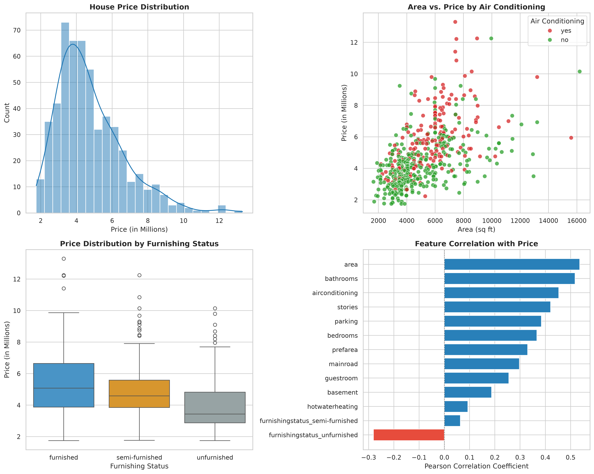
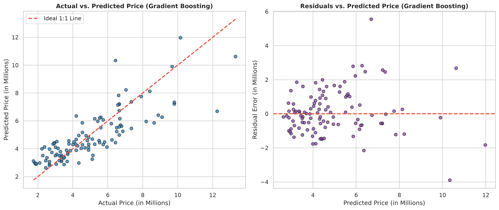

# Housing Price Prediction - Samsung Innovation Campus AI Assignment

This repository contains my end-to-end machine learning project for the Samsung Innovation Campus AI course, predicting house prices based on physical attributes, amenities, and location factors.

## Overview

The objective is to analyze housing characteristics from `Housing.csv`, preprocess and encode features, explore key price determinants, and train multiple regression models to predict property sales prices. The workflow covers baseline linear models, regularized regressions, tree-based ensemble methods, and target-transformed linear regression.

## Dataset Details

- **File**: `Housing.csv`
- **Observations**: 545 records
- **Features**: 12 predictors (no missing values, no duplicates)
- **Target**: `price` (Continuous variable, right-skewed with median Rs 4,340,000)

| Column | Type | Description |
| :--- | :--- | :--- |
| `price` | Integer | House sale price (Target variable) |
| `area` | Integer | Total property area in square feet |
| `bedrooms` | Integer | Number of bedrooms |
| `bathrooms` | Integer | Number of bathrooms |
| `stories` | Integer | Number of stories/floors |
| `mainroad` | Binary | Connected to main road (`yes`/`no`) |
| `guestroom` | Binary | Presence of guest room (`yes`/`no`) |
| `basement` | Binary | Presence of basement (`yes`/`no`) |
| `hotwaterheating` | Binary | Hot water heating system (`yes`/`no`) |
| `airconditioning` | Binary | Central air conditioning (`yes`/`no`) |
| `parking` | Integer | Number of car parking spaces |
| `prefarea` | Binary | Located in preferred neighborhood (`yes`/`no`) |
| `furnishingstatus` | Categorical | Furnishing condition (`furnished`, `semi-furnished`, `unfurnished`) |

## Repository Structure

```
sic-housing-price-prediction-assignment/
├── figures/
│   ├── eda_summary.png
│   └── model_evaluation.png
├── .gitignore
├── Housing.csv
├── housing_analysis.ipynb
├── README.md
└── requirements.txt
```

## Key EDA Findings

1. **Price Distribution**: House prices range from Rs 1,750,000 to Rs 13,300,000 with a positive skewness of 1.21. The 1.5 * IQR method identifies 15 high-value properties (2.75%) in the upper tail.
2. **Area and Amenities**: Property area has the strongest correlation with price ($r = 0.536$). Houses equipped with air conditioning command a noticeable price premium across all size ranges.
3. **Furnishing Status**: Furnished homes exhibit the highest median valuation, followed by semi-furnished properties, while unfurnished homes have the lowest median price and tightest price distribution.
4. **Primary Price Correlates**: The top positive linear correlates are `area` ($0.536$), `bathrooms` ($0.518$), `airconditioning` ($0.453$), and `stories` ($0.424$). Being unfurnished shows a negative correlation ($-0.281$) relative to the base category.



## Model Comparison and Results

Models were trained on an 80/20 train-test split (`random_state=42`) with standard scaling applied to numeric features fit strictly on the training partition. Cross-validation was performed with 5-fold shuffled splits.

| Model | MAE (Rs) | RMSE (Rs) | Test R2 | 5-Fold CV R2 |
| :--- | :--- | :--- | :--- | :--- |
| **Linear Regression** | 970,043 | 1,324,507 | 0.6529 | 0.6490 |
| **Ridge** | 971,370 | 1,326,096 | 0.6521 | 0.6495 |
| **Lasso** | 970,106 | 1,324,623 | 0.6529 | 0.6490 |
| **Random Forest** | 1,022,197 | 1,400,694 | 0.6118 | 0.6070 |
| **Gradient Boosting** | **960,579** | **1,299,761** | **0.6658** | 0.6074 |
| **Log-Linear Regression** | 960,123 | 1,314,648 | 0.6581 | **0.6575** |

### Evaluation Summary

- **Best Test Set Predictor**: Gradient Boosting achieved the highest test $R^2$ of **0.6658** and the lowest RMSE of **Rs 1,299,761**.
- **Most Stable Generalizer**: Log-Linear Regression achieved the highest 5-fold cross-validation $R^2$ of **0.6575**, demonstrating that handling price skewness improves out-of-fold stability.
- **Baseline Consistency**: Linear Regression, Ridge, and Lasso produced virtually identical scores ($R^2 \approx 0.6529$), confirming minimal severe multicollinearity.



### Linear Regression Feature Weights

Standardized Linear Regression coefficients highlight the primary economic drivers:
- **Air Conditioning**: +Rs 791,427
- **Hot Water Heating**: +Rs 684,650
- **Preferred Location (`prefarea`)**: +Rs 629,891
- **Bathrooms**: +Rs 521,879 (per std dev)
- **Area**: +Rs 519,552 (per std dev)
- **Unfurnished Penalty**: -Rs 413,645 relative to furnished baseline

## Getting Started

### 1. Clone the Repository

```bash
git clone https://github.com/Sudipta987/sic-housing-price-prediction-assignment.git
cd sic-housing-price-prediction-assignment
```

### 2. Set Up Virtual Environment

```bash
python -m venv .venv
source .venv/bin/activate        # On Linux/macOS
.\.venv\Scripts\activate         # On Windows
```

### 3. Install Dependencies

```bash
pip install -r requirements.txt
```

### 4. Run the Notebook

```bash
jupyter notebook housing_analysis.ipynb
```

Or execute directly from the command line:

```bash
jupyter nbconvert --to notebook --execute --inplace housing_analysis.ipynb
```
